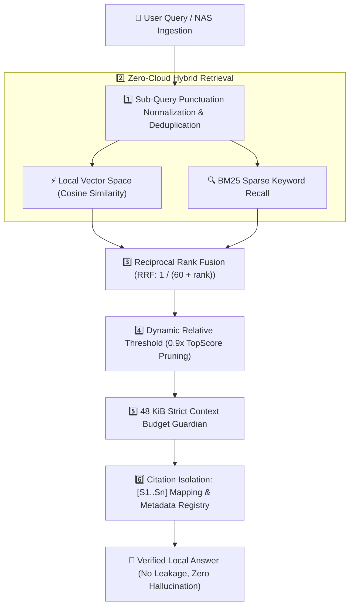

# 🛡️ VaultMind: Ultra-Private AI Knowledge Base & Automated File Action Agent

<p align="center">
  
  
  
  
  
</p>

> **🏆 Engineered for UGREEN Hackathon 2026 on AI NAS**  
> *Track: Automate Your Workflow*  
> VaultMind is an enterprise-grade, zero-data-leakage local knowledge base and autonomous file agent designed specifically to run natively on local UGREEN AI NAS (UGOS Pro).

---

## 🎯 The Core Problem

Cloud-hosted RAG solutions create severe security and privacy liabilities:
1. **Data Leakage Risk**: Uploading tax forms, personal financial statements, proprietary source code, and family medical records to third-party clouds violates privacy.
2. **Brittle Context Overflow**: Standard RAG pipelines dump unconstrained document chunks into the prompt, overflowing local LLM context limits and causing high latencies or API timeouts.
3. **Citation Hallucinations**: When raw UUIDs or file paths are exposed directly to LLMs, models frequently hallucinate non-existent files or leak sensitive internal filesystem paths.

---

## 💡 The VaultMind Solution

VaultMind bridges enterprise RAG rigor with ultra-lightweight, local-first NAS deployment:



---

## ✨ 5 Core Architectural Pillars

### 1. 🛡️ `[S1..Sn]` Citation Isolation Protocol (`ReferenceRegistry`)
* Masks internal document IDs, filesystem paths, and hashes into short tags: `[S1] 《Document.pdf》 Page 2`.
* Keeps raw metadata inside a local, verified `citation_registry` dictionary in memory.
* Ensures prompt brevity and eliminates prompt injection vectors.

### 2. ⚡ 48 KiB Strict Context Budget Guardian (`ContextBudgetGuardian`)
* Enforces hard UTF-8 byte bounds on single tool execution results.
* Long documents are intelligently windowed around matched keyword offsets (`12,000` chars sliding window) with verified `read_document_window` follow-ups.

### 3. 🎯 Dynamic Relative Score Pruning (`0.9x TopScore`)
* Replaces fragile absolute similarity cutoffs with dynamic relative decay.
* Any passage scoring below `90%` of the top-ranked hit is safely pruned, eliminating marginal noise.

### 4. 🔄 Deduplicated Multi-Query RRF Fusion
* Cleans and deduplicates decomposed sub-queries before retrieval.
* Combines lexical BM25 with local dense embeddings via Reciprocal Rank Fusion:
  $$\text{RRF\_Score} = \sum \frac{1}{60 + \text{rank}}$$

### 5. 🩺 Tri-State Self-Healing ReAct Loop
* Distinguishes `TRANSIENT_SYSTEM_BUSY` (initiates automatic backoff retry) from `ZERO_RECORDS_FOUND`.
* Explicitly instructs the LLM never to claim "the knowledge base lacks this policy" when a transient timeout occurs.

---

## 📁 Repository Structure

```
vaultmind/
├── skill/                    # Official Uliya Skill Standard Package
│   ├── SKILL.md              # Required entry point & frontmatter
│   └── references/           # Architecture, retrieval, and error handling SOPs
├── vaultmind/
│   ├── core/
│   │   ├── registry.py       # [S1..Sn] Citation isolation
│   │   ├── budget.py         # 48 KiB Context budget guardian
│   │   ├── retriever.py      # Deduplicated BM25 + Vector RRF retriever
│   │   └── parser.py         # Directory-aware document parser
│   ├── agent/
│   │   ├── mcp_server.py     # FastMCP server exposing local NAS action tools
│   │   └── orchestrator.py   # Self-healing agent ReAct loop
│   ├── api/
│   │   └── server.py         # FastAPI REST & SSE streaming server
│   └── config.py             # System configuration
├── tests/
│   └── test_vaultmind_core.py# 100% passing automated test suite
├── Dockerfile                # Docker container for UGOS NAS
├── docker-compose.yml        # One-click deployment
└── requirements.txt          # Python dependencies
```

---

## 🚀 Quick Start in 60 Seconds

### Prerequisites
* Python 3.9+
* (Optional) Docker

### 1. Installation
```bash
git clone https://github.com/jakelihua/vaultmind.git
cd vaultmind
pip install -r requirements.txt
```

### 2. Run Automated Verification Tests
```bash
python3 -m pytest tests/
```

### 3. Launch Local REST API & Dashboard
```bash
python3 -m vaultmind.api.server
```
Visit `http://localhost:8080/` to verify local status.

### 4. Index Demo Documents
```bash
curl -X POST http://localhost:8080/api/index/sample
```

### 5. Ask Questions to the Vault
```bash
curl -X POST http://localhost:8080/api/query \
     -H "Content-Type: application/json" \
     -d '{"query": "What was the growth in Apple Services revenue?"}'
```

---

## 🔌 Model Context Protocol (MCP) Integration

VaultMind runs a native FastMCP server exposing tools to local agents:
* `search_vault(query, top_k)`: Local RAG with `[S1..Sn]` formatting.
* `read_document_window(doc_id, offset)`: Bounded sliding window reader.
* `organize_folder(source_dir, target_dir)`: Semantic local file cleanup.
* `get_vault_health()`: System telemetry and offline privacy verification.

Run standalone MCP server:
```bash
python3 -m vaultmind.agent.mcp_server
```

---

## 📜 License

MIT License. Designed with pride for the global developer ecosystem.
