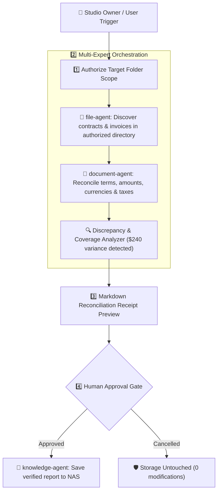

# 🛡️ VaultMind: Local AI Document Reconciliation & NAS Action Agent
### 私有云本地单据智能核对与自动化操作智能体

<p align="center">
  <a href="#english">English</a> | <a href="#中文说明">中文说明</a>
</p>

<p align="center">
  
  
  
  
  
</p>

> **🏆 Engineered for UGREEN Hackathon 2026 on AI NAS**  
> *Track: Automate Your Workflow*  
> **One-sentence summary**: VaultMind checks invoices against contracts in an authorized NAS folder, shows the source of each discrepancy, and saves a review report after you approve it.

---

<a name="english"></a>
## 🇬🇧 English Documentation

### 🎯 The Core Problem
Small studio owners and freelance creators regularly manage dozens of monthly contracts, vendor agreements, and incoming invoices stored across NAS shared drives. Manual month-end reconciliation creates notable operational friction:
1. **Billing Discrepancies**: Subtle variance in hourly billing, unapproved expense line items, or tax mismatches are tedious to spot across multi-page PDFs.
2. **Context Overflow & High Latency**: Sending full multi-page PDFs to cloud APIs creates high latencies and unconstrained token costs.
3. **Ghost References & Path Exposure**: When unconstrained filesystem paths or synthetic IDs are passed directly to language models, models frequently hallucinate non-existent files.
4. **Accidental File Overwrite**: Autonomous AI agents that modify directories without human approval gates risk corrupting business records.

---

### 💡 The VaultMind Solution
VaultMind automates monthly contract-to-invoice reconciliation natively on local NAS storage with human approval:



---

### ✨ Core Architectural Principles

1. **🛡️ Citation Isolation Protocol (`ReferenceRegistry`)**
   * Masks internal document IDs and storage hashes into clean tags: `[S1] 《Studio_Contract.pdf》 Page 2`.
   * Only registers citations for text fragments that actually fit within the byte budget, preventing ghost citations.
   * Keeps file metadata in local memory, presenting clear verifiable references.

2. **⚡ Strict 48 KiB Context Budget Guardian (`ContextBudgetGuardian`)**
   * Enforces hard UTF-8 byte bounds on single tool execution results (49,152 bytes maximum including warning overhead).
   * Long documents are intelligently windowed around matched keyword offsets (`8,000` chars sliding window).

3. **🎯 Dynamic Relative Score Pruning (`0.9x TopScore`)**
   * Replaces fragile absolute similarity cutoffs with dynamic relative decay.
   * Any passage scoring below `90%` of the top-ranked hit is safely pruned, eliminating marginal noise while retaining critical clauses.

4. **🔄 Deduplicated Multi-Query RRF Fusion**
   * Cleans and deduplicates sub-queries before retrieval.
   * Combines lexical BM25 with local dense embeddings via Reciprocal Rank Fusion:
     $$\text{RRF\_Score} = \sum \frac{1}{60 + \text{rank}}$$

5. **🩺 Tri-State Error Handling**
   * Distinguishes `TRANSIENT_SYSTEM_BUSY` (initiates automatic backoff retry) from `ZERO_RECORDS_FOUND`.
   * Never fabricates unverified contract terms when files are missing; clearly flags entries as `Needs Review`.

---

### 📁 Repository Structure
```
vaultmind/
├── skill/                    # Official Uliya Skill Standard Package
│   └── vaultmind-reconcile/  # Verified with Starter Kit v0.7.3 (0 errors, 0 warnings)
│       ├── SKILL.md          # Required entry point & frontmatter
│       └── references/       # Receipt format, reconciliation spec, error handling
├── vaultmind/
│   ├── core/
│   │   ├── registry.py       # Citation isolation & ghost reference prevention
│   │   ├── budget.py         # 48 KiB Context budget guardian
│   │   ├── retriever.py      # Deduplicated BM25 + Vector RRF retriever
│   │   └── parser.py         # Directory-aware document parser
│   ├── agent/
│   │   ├── mcp_server.py     # FastMCP server with budget-enforced inspection tools
│   │   └── orchestrator.py   # ReAct engine with tri-state error handling
│   ├── api/
│   │   └── server.py         # FastAPI REST server with studio reconciliation fixtures
│   └── config.py             # System configuration
├── tests/
│   └── test_vaultmind_core.py# 100% passing automated test suite (7/7 tests)
├── Dockerfile                # Docker container for UGOS NAS
├── docker-compose.yml        # Localhost-bound container deployment (127.0.0.1:8080)
└── requirements.txt          # Python dependencies
```

---

### 🚀 Quick Start in 60 Seconds

```bash
# 1. Clone & Install
git clone https://github.com/jakelihua/vaultmind.git
cd vaultmind
pip install -r requirements.txt

# 2. Run Automated Verification Tests
PYTHONPATH=. pytest tests/ -v

# 3. Launch Local REST API & Seed Reconciliation Fixtures
python3 -m vaultmind.api.server
# Seed mock studio contracts & invoices:
curl -X POST http://127.0.0.1:8080/api/index/sample
```

---

<a name="中文说明"></a>
## 🇨🇳 中文说明文档

### 🎯 解决的核心痛点
小型工作室负责人、独立设计师与中小企业主每月需要在 NAS 共享文件夹中对账大量合同与发票。传统对账方式存在明显痛点：
1. **金额差异排查困难**：多页发票中夹杂的未约定加班费、税点口径不一或金额出入，人工比对费时费力。
2. **上下文超限与高延迟**：直接将完整文档上传云端不仅耗费算力，还经常引发超时或上下文截断。
3. **引用幻觉与路径泄露**：向大模型直接暴露底层物理路径或内部 ID，容易导致模型胡乱捏造虚假文件名或产生幻觉。
4. **非受控改动风险**：缺乏人类审批关卡的自主智能体可能误删或误改业务单据。

---

### 💡 VaultMind 架构五大设计

1. **`[S1..Sn]` 引用标记脱敏与注册表隔离**：
   * 大模型仅能看到 `[S1] 《设计合同_2025.pdf》 第2页` 简短标签；
   * 仅为实际进入模型上下文的片段登记引用，杜绝正文被裁截却残留幽灵引用的漏洞。
2. **48 KiB 严格单次上下文字节熔断**：
   * 包含系统警告信息在内的总返回字节严格限定在 49,152 字节（48 KiB）之内，长文档自动启动以命中点为中心的滑动窗口。
3. **动态相对阈值裁剪（0.9x TopScore）**：
   * 动态取本次召回最高分的 90% 作为截断线，过滤看似相近实则无关的伪关联段落。
4. **子问句归一化去重与 BM25 + 向量 RRF 混合融合**：
   * 对智能体拆解出的子问句执行标点清洗与幂等去重；
   * 通过倒数秩融合（RRF）平衡关键词匹配与语义向量召回。
5. **三态错误恢复机制（Tri-State Recovery）**：
   * 严格区分“系统临时繁忙”与“确实无相关记录”，无匹配合同如实标为 `Needs Review`，拒绝无据推测。

---

### 🔌 Model Context Protocol (MCP) 原生集成
VaultMind 支持 FastMCP，向本地宿主环境提供标准化工具：
* `search_vault(query, top_k)`：带 `[S1..Sn]` 格式化与 48KB 预算约束的本地混合检索。
* `read_document_window(doc_id, offset)`：防爆上下文的文档局部滑动窗口阅读器。
* `organize_folder(source_dir, target_dir)`：按单据类型提出结构化归档建议（模拟模式，受权限保护）。
* `get_vault_health()`：系统监控与本地配置验证。

---

### 🐳 安全 Docker 部署
```bash
docker-compose up -d
```
服务绑定在 `127.0.0.1:8080`，保障安全访问。

---

## 📜 开源协议 / License

本项目采用 [MIT License](LICENSE) 授权协议。100% 净室独立编写，专为全球开发者生态与私有云 NAS 用户打造。
