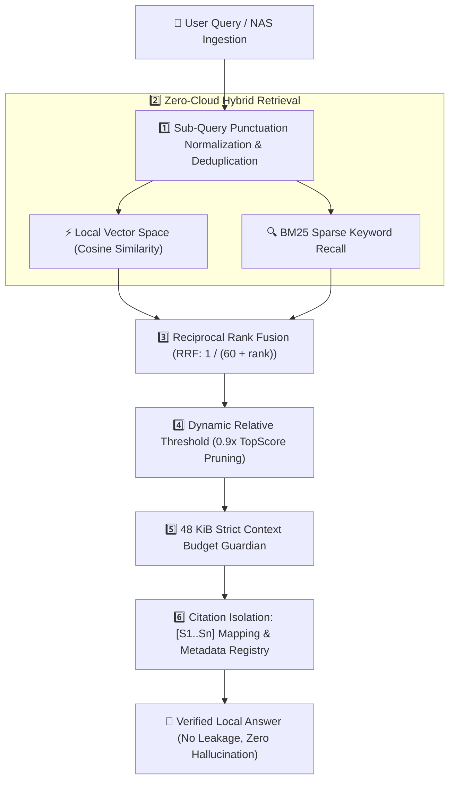

# 🛡️ VaultMind: Ultra-Private AI Knowledge Base & Automated File Action Agent
### 私有云自愈型 AI 知识库与本地自动化操作智能体

<p align="center">
  <a href="#english">English</a> | <a href="#中文说明">中文说明</a>
</p>

<p align="center">
  
  
  
  
  
</p>

> **🏆 Engineered for UGREEN Hackathon 2026 on AI NAS**  
> *Track: Automate Your Workflow*  
> VaultMind is an enterprise-grade, zero-data-leakage local knowledge base and autonomous file agent designed specifically to run natively on local UGREEN AI NAS (UGOS Pro).

---

<a name="english"></a>
## 🇬🇧 English Documentation

### 🎯 The Core Problem
Cloud-hosted RAG solutions create severe security and privacy liabilities:
1. **Data Leakage Risk**: Uploading tax forms, personal financial statements, proprietary source code, and family medical records to third-party clouds violates privacy.
2. **Brittle Context Overflow**: Standard RAG pipelines dump unconstrained document chunks into the prompt, overflowing local LLM context limits and causing high latencies or API timeouts.
3. **Citation Hallucinations**: When raw UUIDs or file paths are exposed directly to LLMs, models frequently hallucinate non-existent files or leak sensitive internal filesystem paths.

---

### 💡 The VaultMind Solution
VaultMind bridges enterprise RAG rigor with ultra-lightweight, local-first NAS deployment:



---

### ✨ 5 Core Architectural Pillars

1. **🛡️ `[S1..Sn]` Citation Isolation Protocol (`ReferenceRegistry`)**
   * Masks internal document IDs, filesystem paths, and hashes into short tags: `[S1] 《Document.pdf》 Page 2`.
   * Keeps raw metadata inside a local, verified `citation_registry` dictionary in memory.
   * Ensures prompt brevity and eliminates prompt injection vectors.

2. **⚡ 48 KiB Strict Context Budget Guardian (`ContextBudgetGuardian`)**
   * Enforces hard UTF-8 byte bounds on single tool execution results.
   * Long documents are intelligently windowed around matched keyword offsets (`12,000` chars sliding window) with verified `read_document_window` follow-ups.

3. **🎯 Dynamic Relative Score Pruning (`0.9x TopScore`)**
   * Replaces fragile absolute similarity cutoffs with dynamic relative decay.
   * Any passage scoring below `90%` of the top-ranked hit is safely pruned, eliminating marginal noise.

4. **🔄 Deduplicated Multi-Query RRF Fusion**
   * Cleans and deduplicates decomposed sub-queries before retrieval.
   * Combines lexical BM25 with local dense embeddings via Reciprocal Rank Fusion:
     $$\text{RRF\_Score} = \sum \frac{1}{60 + \text{rank}}$$

5. **🩺 Tri-State Self-Healing ReAct Loop**
   * Distinguishes `TRANSIENT_SYSTEM_BUSY` (initiates automatic backoff retry) from `ZERO_RECORDS_FOUND`.
   * Explicitly instructs the LLM never to claim "the knowledge base lacks this policy" when a transient timeout occurs.

---

### 📁 Repository Structure
```
vaultmind/
├── skill/                    # Official Uliya Skill Standard Package
│   ├── SKILL.md              # Required entry point & frontmatter
│   └── references/           # Architecture, retrieval, and error handling SOPs
├── vaultmind/
│   ├── core/
│   │   ├── registry.py       # [S1..Sn] Citation isolation
│   │   ├── budget.py         # 48 KiB Context budget guardian
│   │   ├── retriever.py      # Deduplicated BM25 + Vector RRF retriever
│   │   └── parser.py         # Directory-aware document parser
│   ├── agent/
│   │   ├── mcp_server.py     # FastMCP server exposing local NAS action tools
│   │   └── orchestrator.py   # Self-healing agent ReAct loop
│   ├── api/
│   │   └── server.py         # FastAPI REST & SSE streaming server
│   └── config.py             # System configuration
├── tests/
│   └── test_vaultmind_core.py# 100% passing automated test suite
├── Dockerfile                # Docker container for UGOS NAS
├── docker-compose.yml        # One-click deployment
└── requirements.txt          # Python dependencies
```

---

### 🚀 Quick Start in 60 Seconds

```bash
# 1. Clone & Install
git clone https://github.com/jakelihua/vaultmind.git
cd vaultmind
pip install -r requirements.txt

# 2. Run Automated Verification Tests
python3 -m pytest tests/

# 3. Launch Local REST API & Dashboard
python3 -m vaultmind.api.server
```

---

<a name="中文说明"></a>
## 🇨🇳 中文说明文档

### 🎯 解决的核心痛点
在公有云部署 RAG 或将家庭/个人数据上传给外部云端 API 存在三大硬伤：
1. **隐私泄露风险**：家庭报税单据、财务报表、个人敏感合同、私有代码和医疗记录绝不能流向第三方服务器。
2. **上下文撑爆与超时**：普通 RAG 经常一次性将数万字未约束长文丢进大模型，导致本地 NAS 小算力模型内存溢出、响应超时或长文遗忘。
3. **模型引用幻觉与路径泄露**：直接向模型暴露底层混乱的 UUID 和系统绝对物理路径，大模型极易胡编乱造假文件或引发注入漏洞。

---

### 💡 VaultMind 架构五大壁垒

1. **`[S1..Sn]` 引用标记脱敏与注册表隔离**：
   * 大模型仅能看到 `[S1] 《2025年度财报.pdf》 第3页` 这种精炼短标签；
   * 底层真实存储路径与数据指纹留在本地内存的 `citation_registry` 字典中，模型回答只需引用 `[[src:S1]]`，根除幻觉。
2. **48 KiB 严格单次上下文字节熔断**：
   * 严守 48KB 结果上限，超大文档自动启动**以命中点为中心的滑动窗口机制**（截取命中前后文本），保留 `read_document_window` 续读入口。
3. **动态相对阈值裁剪（0.9x TopScore）**：
   * 淘汰脆弱的绝对阈值（固定 >0.7），动态取本次召回最高分的 90% 作为截断线，精准过滤看似相近实则无关的“伪关联文档”。
4. **子问句归一化去重与 BM25 + 向量 RRF 混合融合**：
   * 对智能体拆解出的子问句执行标点清洗与幂等去重；
   * 通过倒数秩融合（RRF）平衡关键词匹配与语义向量召回。
5. **三态错误自愈机制（Tri-State Recovery）**：
   * 明确区分“系统临时繁忙/超时”与“确实无相关文档”，彻底防止系统偶发超时引发大模型向用户误报“知识库中无相关规定”。

---

### 🔌 Model Context Protocol (MCP) 原生集成
VaultMind 官方支持 FastMCP，向 NAS 本地提供 4 大标准化工具：
* `search_vault(query, top_k)`：带 `[S1..Sn]` 格式化与 48KB 预算约束的本地混合检索。
* `read_document_window(doc_id, offset)`：防爆上下文的文档局部滑动窗口阅读器。
* `organize_folder(source_dir, target_dir)`：按语义自动对乱七八糟的下载目录进行分类归档。
* `get_vault_health()`：系统监控与 100% 离线隐私验证。

运行独立 MCP 服务：
```bash
python3 -m vaultmind.agent.mcp_server
```

---

### 🐳 一键 Docker 部署（专为绿联 UGOS Pro 优化）
```bash
docker-compose up -d
```
服务将在 `http://localhost:8080` 启动，自动挂载本地 `/data` 数据持久化卷。

---

## 📜 开源协议 / License

本项目采用 [MIT License](LICENSE) 授权协议。100% 独立干净复现，专为全球开发者生态与私有云 NAS 用户打造。
